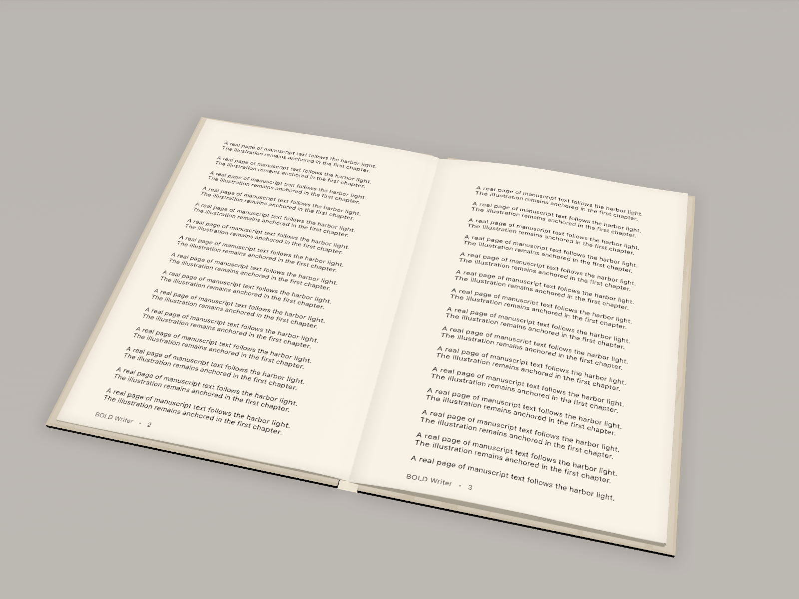

<div align="center">
  

  <p><strong>Be Bold. Write Freely. Publish Beautifully.</strong></p>
  <p>Free, open-source macOS software for writing, designing, and publishing books.</p>

  <p>
    <a href="https://github.com/jorgenandrewjohnson-jpg/BOLDWriter/actions/workflows/macos-focused.yml"></a>
    <a href="LICENSE"></a>
    <a href="Docs/OpenSourceStatus.md"></a>
  </p>

  <p><a href="https://jorgenandrewjohnson-jpg.github.io/BOLDWriter/">Project website</a> · <a href="CONTRIBUTING.md">Start contributing</a> · <a href="https://github.com/jorgenandrewjohnson-jpg/BOLDWriter/issues">Find an issue</a> · <a href="https://github.com/jorgenandrewjohnson-jpg/BOLDWriter/discussions">Join the discussion</a> · <a href="Docs/Roadmap.md">Roadmap</a></p>
</div>

> **Work in progress.** The source builds, but BOLD Writer is not yet a notarized, generally supported macOS release. Test with copies of your documents and check print output against your printer's requirements.

## Why I opened this project

BOLD Writer began as one person's attempt to give authors better tools for creating professional books. The project grew beyond what I can reasonably finish alone. I am opening it to the world because authors deserve powerful, accessible publishing software, and because programmers, designers, writers, and students can make it better together.

The goal is a single native studio for the journey from first paragraph to a designed book. There is real code here, real unfinished engineering, and room for contributors to shape what comes next. **Let's be BOLD together.**

## What you can explore today

| Workspace | Current capability | Where help is needed |
| --- | --- | --- |
| Manuscript editor | Native rich text, styles, search, outline navigation, comments, bookmarks, undo/redo, and `.boldwriter` packages | Reliability and long-book acceptance |
| Word documents | DOCX import/export for many text, section, table, image, and drawing structures; focused tests cover floating artwork crops, anchors, rotation, and wrap polygons | More Word fixtures and faithful round trips |
| Page layout and publishing | Paginated preview, PDF export, facing-page options, running content, and Book Health checks for geometry, fonts, and effective raster resolution | Typography, accessibility, printer-specific proofing |
| Cover Creator | Editable text and image layers, crops, masks, groups, alignment, guides, and print-wrap geometry | End-to-end GUI acceptance and design polish |
| Physical 3D book | Native preview using manuscript pages and cover artwork; synthetic rendering tests include illustrated pages | Interaction, repeated-open memory checks, visual realism |

The [development status](Docs/OpenSourceStatus.md) separates implemented behavior from focused tests and still-pending installed-app acceptance. Optional AI and audiobook workflows exist; ordinary writing, saving, and export need no AI account.

<p align="center"><br><small>Actual 3D render from a disposable synthetic manuscript. This is renderer evidence, not an interactive GUI acceptance claim.</small></p>

The [project website](https://jorgenandrewjohnson-jpg.github.io/BOLDWriter/) shows this proof and links to the current work. Genuine application-window screenshots will be added after a privacy-safe GUI capture with disposable content.

## Try the source on macOS

You need macOS 14 or later and a full Xcode installation. The current engineering build uses Xcode 26.6. SwiftPM and the Xcode project share application sources; SwiftPM uses vendored LAME source and downloads no package dependencies.

```sh
git clone https://github.com/jorgenandrewjohnson-jpg/BOLDWriter.git
cd BOLDWriter
export DEVELOPER_DIR=/Applications/Xcode.app/Contents/Developer
export TMPDIR=/tmp
swift test -j 1 --filter DOCXImageTests
swift build -c release -j 1
Scripts/bold xcode-build
```

The native app is built at `DerivedDataRelease/Build/Products/Release/BOLD Writer.app`. Inspect any running BOLD Writer session for unsaved work and close it normally before installation. `Scripts/bold install` backs up the previous bundle and `Scripts/bold verify-install` checks installed source identity and signature. An ad-hoc signature is not Developer ID signing or notarization. No verified downloadable binary is offered yet.

The full test suite has previously used excessive memory in one process, so contributors should start with focused tests and report exact counts, skips, and GUI checks. See [CONTRIBUTING.md](CONTRIBUTING.md) for a first pull request and [the architecture guide](Docs/ArchitectureCurrent.md) for code locations.

## Help build BOLD Writer

- **Developers:** Pick a [good first issue](https://github.com/jorgenandrewjohnson-jpg/BOLDWriter/labels/good%20first%20issue) or a [help wanted task](https://github.com/jorgenandrewjohnson-jpg/BOLDWriter/labels/help%20wanted). For larger changes, explain the document workflow and test plan first.
- **Designers:** Review Cover Creator, accessibility, visual hierarchy, and the book preview. Share permission-cleared examples only.
- **Authors:** Tell us which writing and publishing steps are frustrating. Use synthetic excerpts in public reports; keep your manuscript private.
- **Everyone:** Read the [Code of Conduct](CODE_OF_CONDUCT.md), ask questions in [Discussions](https://github.com/jorgenandrewjohnson-jpg/BOLDWriter/discussions), and send fixes through pull requests.

## Project stewardship and licenses

Authors own their documents. Do not attach private manuscripts, unpublished illustrations, credentials, or personal information to public issues. Use synthetic or redistribution-cleared fixtures for tests. The original nine research ZIP archives and private development history are not part of this public source snapshot.

BOLD Writer's own code uses [MIT](LICENSE). Vendored LAME source carries separate LGPL obligations. Adapted WordCraft and Fabric.js code retains its MIT provenance. Read the [third-party inventory](Docs/ThirdPartyAttribution.md) and [source snapshot note](SOURCE_SNAPSHOT.md) before redistributing a binary or adapting more code.
